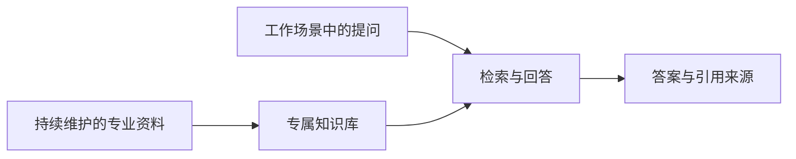

# 知识服务与智能问答

[← 返回主页](../README.md)

面向企业流程咨询、技术查询与专业资料使用场景，将持续积累的文档接入日常问答与内容工作。

## 业务需求

项目覆盖两类使用场景：

- **企业知识查询**：员工在既有协作平台内询问流程或技术问题，回答应关联内部资料，并能追溯到具体来源。
- **专业内容支持**：用户可持续加入专业文件，基于资料开展选题与写作辅助。

## 应用设计

企业问答项目采用本地部署的 FastGPT 知识库，并接入钉钉机器人。用户在群内提问，应用检索本地知识内容并在回答中引用来源；知识内容由客户自行维护。

首期范围聚焦资料问答，优先打通使用入口、知识维护与答案追溯。工作计划生成等复杂逻辑未纳入该期交付范围。

## 参与环节

客户需求沟通、使用流程与功能范围梳理、方案讨论、功能实施、测试验收及交付跟进。

## 交付情况

企业知识问答及专业资料应用均已交付使用。本页为应用案例说明。
