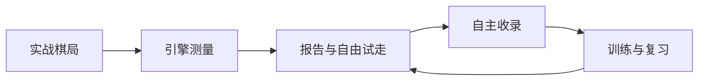

# 棋谱屋：从复盘到训练

[← 返回主页](../README.md)

连接实战棋局、引擎分析与针对性练习的个人象棋学习系统。

产品围绕日常复盘与练习持续迭代，包括逐着评价、自由推演、个人训练材料、复习安排及跨盘重复开局的学习。完整产品用于个人日常训练，也曾提供棋手试用。

设计重点包括：将棋盘评价与学习状态分开；保留评分来源与历史；让个人收录、练习反馈与原局上下文保持联系。原题表现与跨局面迁移分开判断。

精选代码仓库展示训练编排这一独立模块，配套合成题目的可运行示例。[查看精选代码与演示 →](https://github.com/ShenTenghui/qipuwu)
